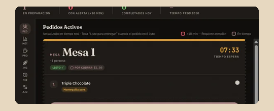
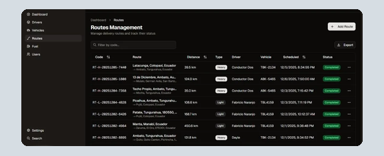
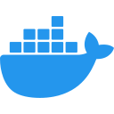

[Español](README.md) · **English**

<a href="https://dageus15.github.io/en/">
  <picture>
    <source media="(prefers-reduced-motion: reduce) and (prefers-color-scheme: dark)" srcset="assets/glass-dark.png">
    <source media="(prefers-reduced-motion: reduce)" srcset="assets/glass-light.png">
    <source media="(prefers-color-scheme: dark)" srcset="assets/glass-dark.gif">
    
  </picture>
</a>

Backend developer working with Java and Spring Boot. At **Alquimiasoft** I build microservices and REST APIs with over 95% test coverage. My NestJS and Next.js projects cover distributed systems, biometrics and real-time ordering.

**[Portfolio](https://dageus15.github.io/en/) · [LinkedIn](https://www.linkedin.com/in/dayle-garcia/)**

## Featured projects

<table>
  <tr>
    <td width="50%" valign="top">
       
      <strong>CTT-FISEI course assistant</strong> 
      I designed and tested the Telegram assistant and its live handover dashboard. I orchestrated the AI agents that wrote the code. 
      <a href="https://dageus15.github.io/en/projects/helpdesk/">Case study</a> · <a href="https://github.com/DaGeus15/helpdesk_agent_uta">Repository</a>
    </td>
    <td width="50%" valign="top">
       
      <strong>Fiado</strong> 
      I built the liveness check, the ID card face match, the QR handoff to the phone, sign-up and sessions. 
      <a href="https://dageus15.github.io/en/projects/fiado/">Case study</a>
    </td>
  </tr>
  <tr>
    <td valign="top">
       
      <strong>KAPHIY</strong> 
      I worked on the data model, the ordering API and the WebSocket channel of a system in production. 
      <a href="https://dageus15.github.io/en/projects/kaphiy/">Case study</a> · <a href="https://github.com/Arkasys-GDP/Kaphiy">Team repository</a>
    </td>
    <td valign="top">
       
      <strong>Gasoline System</strong> 
      I built microservices, gRPC contracts and NATS events to track a fleet's fuel, in a team of four. 
      <a href="https://dageus15.github.io/en/projects/gasoline/">Case study</a> · <a href="https://github.com/Application-Distributed-Gasoline-System/Backend">Backend repository</a>
    </td>
  </tr>
</table>

[See all seven case studies](https://dageus15.github.io/en/projects/) · [Read the technical notes](https://dageus15.github.io/en/notes/)

On [Booking View](https://dageus15.github.io/en/projects/booking/) I worked on the REST API and the React Native app for booking properties. [Team repository](https://github.com/DaGeus15/BookingView)

## My stack

<table>
  <tr>
    <th scope="row" align="left"><a href="https://dageus15.github.io/en/experience/#stack-backend">Backend</a></th>
    <td>  </td>
    <td>Java · Spring Boot · Node.js · NestJS</td>
  </tr>
  <tr>
    <th scope="row" align="left"><a href="https://dageus15.github.io/en/experience/#stack-data">Data</a></th>
    <td>  </td>
    <td>PostgreSQL · MySQL · MongoDB · Prisma</td>
  </tr>
  <tr>
    <th scope="row" align="left"><a href="https://dageus15.github.io/en/experience/#stack-devops">Testing and delivery</a></th>
    <td> </td>
    <td>Mockito · Docker · GitHub Actions · Azure</td>
  </tr>
  <tr>
    <th scope="row" align="left"><a href="https://dageus15.github.io/en/experience/#stack-frontend">Interfaces</a></th>
    <td>  </td>
    <td>Next.js · React · TypeScript · Flutter</td>
  </tr>
</table>

[See my full stack](https://dageus15.github.io/en/experience/#stack)

Protocols and tools

- **APIs and messaging** · REST, Swagger/OpenAPI, gRPC, NATS, Socket.IO
- **Persistence and auth** · JPA/Hibernate, SQL, PL/SQL, JWT
- **Delivery and interfaces** · Docker Compose, Git, Vercel, React Native, Tailwind CSS

### Currently learning data science

 Python for data science · analysis and visualization with Power BI

I completed **Data Science Essentials with Python** (Cisco, 2026) and solved its five open-ended projects with pandas, matplotlib and scikit-learn in [data-science-essentials-python](https://github.com/DaGeus15/data-science-essentials-python).

[See my education](https://dageus15.github.io/en/about/#about)

## Contributions

<a href="https://github.com/DaGeus15?tab=overview">
  <picture>
    <source media="(prefers-reduced-motion: reduce) and (prefers-color-scheme: dark)" srcset="https://raw.githubusercontent.com/DaGeus15/DaGeus15/output/github-contribution-grid-snake-dark-still.svg">
    <source media="(prefers-reduced-motion: reduce)" srcset="https://raw.githubusercontent.com/DaGeus15/DaGeus15/output/github-contribution-grid-snake-still.svg">
    <source media="(prefers-color-scheme: dark)" srcset="https://raw.githubusercontent.com/DaGeus15/DaGeus15/output/github-contribution-grid-snake-dark.svg">
    
  </picture>
</a>
