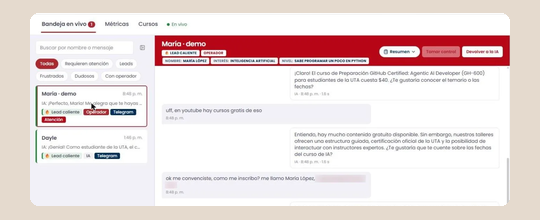
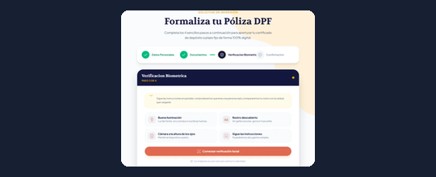
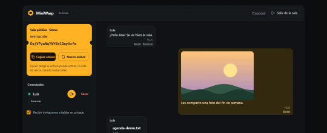

[Español](README.md) · **English**

<a href="https://dayle.dev/en/">
  <picture>
    <source media="(prefers-reduced-motion: reduce) and (prefers-color-scheme: dark)" srcset="assets/glass-dark.png">
    <source media="(prefers-reduced-motion: reduce)" srcset="assets/glass-light.png">
    <source media="(prefers-color-scheme: dark)" srcset="assets/glass-dark.gif">
    
  </picture>
</a>

Software Engineer. I work mostly on the backend with Java and Spring Boot, and also full stack with NestJS, React and Next.js. At **Alquimiasoft** I build microservices and REST APIs with over 95% test coverage.

**[Portfolio](https://dayle.dev/en/) · [LinkedIn](https://www.linkedin.com/in/dayle-garcia/)**

## Featured projects

<table>
  <tr>
    <td width="50%" valign="top">
       
      <strong>CTT-FISEI course assistant</strong> 
      I designed and tested the Telegram assistant and its live handover dashboard. I orchestrated the AI agents that wrote the code. 
      <a href="https://dayle.dev/en/projects/helpdesk/">Case study</a> · <a href="https://github.com/DaGeus15/helpdesk_agent_uta">Repository</a>
    </td>
    <td width="50%" valign="top">
       
      <strong>Fiado</strong> 
      I built the liveness check, the ID card face match, the QR handoff to the phone, sign-up and sessions. 
      <a href="https://dayle.dev/en/projects/fiado/">Case study</a>
    </td>
  </tr>
  <tr>
    <td valign="top">
       
      <strong>KAPHIY</strong> 
      I worked on the data model, the ordering API and the WebSocket channel of a system in production. 
      <a href="https://dayle.dev/en/projects/kaphiy/">Case study</a> · <a href="https://github.com/Arkasys-GDP/Kaphiy">Team repository</a>
    </td>
    <td valign="top">
       
      <strong>MiniWasp</strong> 
      My own project, live: ephemeral messaging with no accounts, per-room encrypted attachments, on-server AI moderation and WebRTC video calls. 
      <a href="https://dayle.dev/en/projects/miniwasp/">Case study</a> · <a href="https://miniwasp.dayle.dev">Live app</a> · <a href="https://github.com/DaGeus15/miniwasp">Repository</a>
    </td>
  </tr>
</table>

[See every case study](https://dayle.dev/en/projects/) · [Read the technical notes](https://dayle.dev/en/notes/)

On [Booking View](https://dayle.dev/en/projects/booking/) I worked on the REST API and the React Native app for booking properties. [Team repository](https://github.com/DaGeus15/BookingView)

## Technical notes

<table>
  <tr>
    <td width="50%" valign="top">
      <strong>Rotating refresh tokens without logging anyone out on a double click</strong> 
      Every refresh swaps the token, and reusing an old one ends the whole session. The catch: two tabs refreshing at once look like theft.  
      <a href="https://dayle.dev/en/notes/refresh-token-rotation/">Read the note →</a>
    </td>
    <td width="50%" valign="top">
      <strong>The Ecuadorian ID card has two faces</strong> 
      Face verification worked with the test photos and rejected almost every real ID card. Four fixes, and a threshold calibrated with data.  
      <a href="https://dayle.dev/en/notes/id-card-two-faces/">Read the note →</a>
    </td>
  </tr>
</table>

## My stack

<a href="https://dayle.dev/en/experience/#stack">
  <picture>
    <source media="(prefers-color-scheme: dark)" srcset="https://raw.githubusercontent.com/DaGeus15/DaGeus15/output/stack-en-dark.svg">
    
  </picture>
</a>

[See my full stack](https://dayle.dev/en/experience/#stack) · Protocols and tools: REST, Swagger/OpenAPI, gRPC, NATS, Socket.IO, WebRTC, JPA/Hibernate, JWT, Mockito, Vercel, Tailwind CSS

### Currently learning data science

I completed **Data Science Essentials with Python** (Cisco, 2026) and solved its five open-ended projects with pandas, matplotlib and scikit-learn in [data-science-essentials-python](https://github.com/DaGeus15/data-science-essentials-python).

[See my education](https://dayle.dev/en/about/#about)

## Who I build with

<picture>
  <source media="(prefers-color-scheme: dark)" srcset="https://raw.githubusercontent.com/DaGeus15/DaGeus15/output/collaborators-en-dark.svg">
  
</picture>

## Contributions

<picture>
  <source media="(prefers-color-scheme: dark)" srcset="https://raw.githubusercontent.com/DaGeus15/DaGeus15/output/activity-en-dark.svg">
  
</picture>

<a href="https://github.com/DaGeus15?tab=overview">
  <picture>
    <source media="(prefers-reduced-motion: reduce) and (prefers-color-scheme: dark)" srcset="https://raw.githubusercontent.com/DaGeus15/DaGeus15/output/github-contribution-grid-snake-dark-still.svg">
    <source media="(prefers-reduced-motion: reduce)" srcset="https://raw.githubusercontent.com/DaGeus15/DaGeus15/output/github-contribution-grid-snake-still.svg">
    <source media="(prefers-color-scheme: dark)" srcset="https://raw.githubusercontent.com/DaGeus15/DaGeus15/output/github-contribution-grid-snake-dark.svg">
    
  </picture>
</a>
