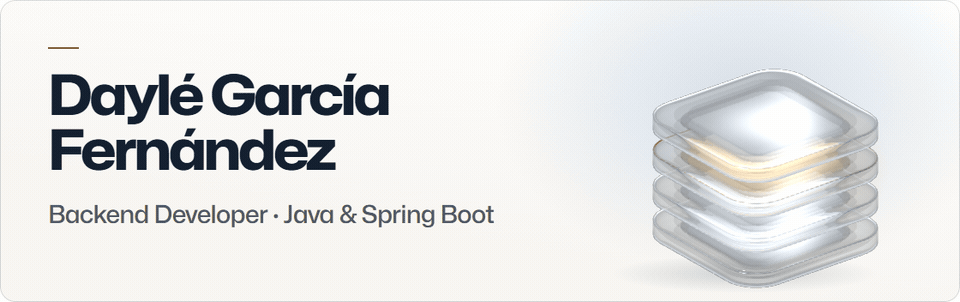
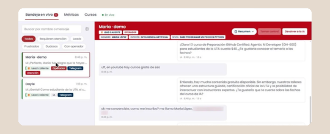
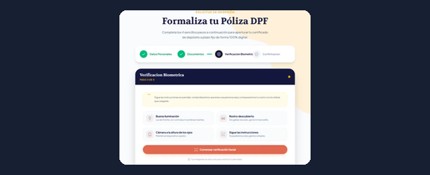
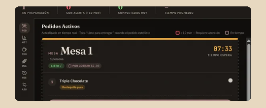
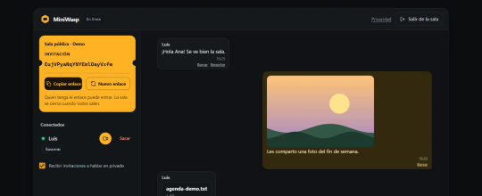

**Español** · [English](README.en.md)

<a href="https://dayle.dev/es/">
  <picture>
    <source media="(prefers-reduced-motion: reduce) and (prefers-color-scheme: dark)" srcset="assets/glass-dark.png">
    <source media="(prefers-reduced-motion: reduce)" srcset="assets/glass-light.png">
    <source media="(prefers-color-scheme: dark)" srcset="assets/glass-dark.gif">
    
  </picture>
</a>

Software Engineer. Trabajo sobre todo en backend con Java y Spring Boot, y también en full stack con NestJS, React y Next.js. En **Alquimiasoft** desarrollo microservicios y APIs REST con más del 95 % de cobertura de pruebas.

**[Portafolio](https://dayle.dev/es/) · [LinkedIn](https://www.linkedin.com/in/dayle-garcia/)**

## Proyectos destacados

<table>
  <tr>
    <td width="50%" valign="top">
       
      <strong>Asistente de cursos CTT-FISEI</strong> 
      Diseñé y probé el asistente de Telegram y su panel de intervención en vivo. Orquesté los agentes de IA que escribieron el código. 
      <a href="https://dayle.dev/es/projects/helpdesk/">Caso de estudio</a> · <a href="https://github.com/DaGeus15/helpdesk_agent_uta">Repositorio</a>
    </td>
    <td width="50%" valign="top">
       
      <strong>Fiado</strong> 
      Implementé la prueba de vida, la comparación con la cédula, el traspaso por QR, el registro y la sesión. 
      <a href="https://dayle.dev/es/projects/fiado/">Caso de estudio</a>
    </td>
  </tr>
  <tr>
    <td valign="top">
       
      <strong>KAPHIY</strong> 
      Trabajé en el modelo de datos, la API de pedidos y el canal WebSocket de un sistema en producción. 
      <a href="https://dayle.dev/es/projects/kaphiy/">Caso de estudio</a> · <a href="https://github.com/Arkasys-GDP/Kaphiy">Repositorio del equipo</a>
    </td>
    <td valign="top">
       
      <strong>MiniWasp</strong> 
      Proyecto propio, en producción: mensajería temporal sin cuentas, adjuntos cifrados por sala, moderación con IA dentro del servidor y videollamadas WebRTC. 
      <a href="https://dayle.dev/es/projects/miniwasp/">Caso de estudio</a> · <a href="https://miniwasp.up.railway.app">App en vivo</a> · <a href="https://github.com/DaGeus15/miniwasp">Repositorio</a>
    </td>
  </tr>
</table>

[Ver todos los casos de estudio](https://dayle.dev/es/projects/) · [Leer las notas técnicas](https://dayle.dev/es/notes/)

En [Booking View](https://dayle.dev/es/projects/booking/) trabajé en la API REST y la app de React Native para reservar inmuebles. [Repositorio del equipo](https://github.com/DaGeus15/BookingView)

## Notas técnicas

<table>
  <tr>
    <td width="50%" valign="top">
      <strong>Rotar el refresh token sin echar a nadie por un doble clic</strong> 
      Cada renovación cambia el token y reusar uno viejo cierra la sesión entera. La trampa: dos pestañas renovando a la vez parecen un robo.  
      <a href="https://dayle.dev/es/notes/refresh-token-rotation/">Leer la nota →</a>
    </td>
    <td width="50%" valign="top">
      <strong>La cédula ecuatoriana tiene dos caras</strong> 
      La verificación facial funcionaba con las fotos de prueba y rechazaba casi todas las cédulas reales. Cuatro arreglos, y un umbral calibrado con datos.  
      <a href="https://dayle.dev/es/notes/id-card-two-faces/">Leer la nota →</a>
    </td>
  </tr>
</table>

## Mi stack

<a href="https://dayle.dev/es/experience/#stack">
  <picture>
    <source media="(prefers-color-scheme: dark)" srcset="https://raw.githubusercontent.com/DaGeus15/DaGeus15/output/stack-es-dark.svg">
    
  </picture>
</a>

[Ver mi stack completo](https://dayle.dev/es/experience/#stack) · Protocolos y herramientas: REST, Swagger/OpenAPI, gRPC, NATS, Socket.IO, WebRTC, JPA/Hibernate, JWT, Mockito, Vercel, Tailwind CSS

### Actualmente aprendiendo Ciencia de Datos

Terminé **Data Science Essentials with Python** (Cisco, 2026). Resolví sus cinco proyectos abiertos con pandas, matplotlib y scikit-learn en [data-science-essentials-python](https://github.com/DaGeus15/data-science-essentials-python).

[Ver mi formación](https://dayle.dev/es/about/#about)

## Con quién construyo

<picture>
  <source media="(prefers-color-scheme: dark)" srcset="https://raw.githubusercontent.com/DaGeus15/DaGeus15/output/collaborators-es-dark.svg">
  
</picture>

## Contribuciones

<picture>
  <source media="(prefers-color-scheme: dark)" srcset="https://raw.githubusercontent.com/DaGeus15/DaGeus15/output/activity-es-dark.svg">
  
</picture>

<a href="https://github.com/DaGeus15?tab=overview">
  <picture>
    <source media="(prefers-reduced-motion: reduce) and (prefers-color-scheme: dark)" srcset="https://raw.githubusercontent.com/DaGeus15/DaGeus15/output/github-contribution-grid-snake-dark-still.svg">
    <source media="(prefers-reduced-motion: reduce)" srcset="https://raw.githubusercontent.com/DaGeus15/DaGeus15/output/github-contribution-grid-snake-still.svg">
    <source media="(prefers-color-scheme: dark)" srcset="https://raw.githubusercontent.com/DaGeus15/DaGeus15/output/github-contribution-grid-snake-dark.svg">
    
  </picture>
</a>
