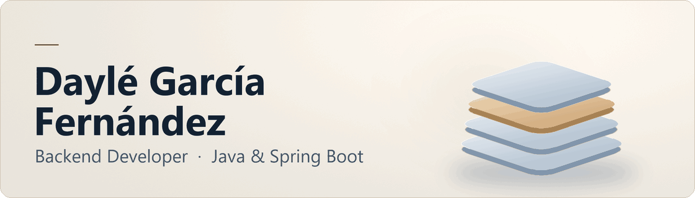
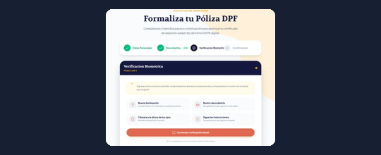
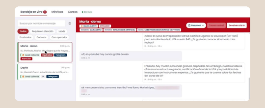
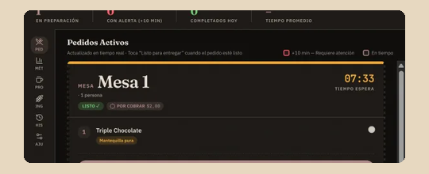
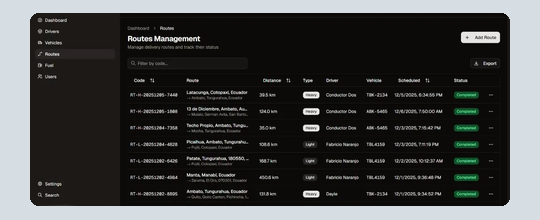
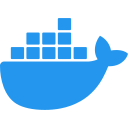

<a href="https://dageus15.github.io/es/">
  <picture>
    <source media="(prefers-reduced-motion: reduce) and (prefers-color-scheme: dark)" srcset="assets/profile-dark.png">
    <source media="(prefers-reduced-motion: reduce)" srcset="assets/profile-light.png">
    <source media="(prefers-color-scheme: dark)" srcset="assets/profile-dark.gif">
    
  </picture>
</a>

Desarrollo microservicios, APIs REST y pruebas automatizadas en **Alquimiasoft**. En mis proyectos con NestJS y Next.js he trabajado en sistemas distribuidos, verificación de identidad y pedidos en tiempo real.

**[Portafolio](https://dageus15.github.io/es/) · [Portfolio in English](https://dageus15.github.io/en/) · [LinkedIn](https://www.linkedin.com/in/dayle-garcia/)**

## Proyectos destacados

<table>
  <tr>
    <td width="50%" valign="top">
       
      <strong>Fiado</strong> 
      Implementé la prueba de vida, la comparación con la cédula, el traspaso por QR, el registro y la sesión. 
      <a href="https://dageus15.github.io/es/projects/fiado/">Caso de estudio</a>
    </td>
    <td width="50%" valign="top">
       
      <strong>Asistente de cursos CTT-FISEI</strong> 
      Diseñé y probé el asistente de Telegram y su panel de intervención en vivo. Orquesté los agentes de IA que escribieron el código. 
      <a href="https://dageus15.github.io/es/projects/helpdesk/">Caso de estudio</a> · <a href="https://github.com/DaGeus15/helpdesk_agent_uta">Repositorio</a>
    </td>
  </tr>
  <tr>
    <td valign="top">
       
      <strong>KAPHIY</strong> 
      Trabajé en el modelo de datos, la API de pedidos y el canal WebSocket de un sistema en producción. 
      <a href="https://dageus15.github.io/es/projects/kaphiy/">Caso de estudio</a> · <a href="https://github.com/Arkasys-GDP/Kaphiy">Repositorio del equipo</a>
    </td>
    <td valign="top">
       
      <strong>Gasoline System</strong> 
      Implementé microservicios, contratos gRPC y eventos NATS para el control de combustible de una flota, en un equipo de cuatro. 
      <a href="https://dageus15.github.io/es/projects/gasoline/">Caso de estudio</a> · <a href="https://github.com/Application-Distributed-Gasoline-System/Backend">Repositorio del backend</a>
    </td>
  </tr>
</table>

[Ver los siete casos de estudio](https://dageus15.github.io/es/projects/) · [Leer las notas técnicas](https://dageus15.github.io/es/notes/)

En [Booking View](https://dageus15.github.io/es/projects/booking/) trabajé en la API REST y la app de React Native para reservar inmuebles. [Repositorio del equipo](https://github.com/DaGeus15/BookingView)

## Stack

[Explorar la pila interactiva y ver dónde usé cada tecnología](https://dageus15.github.io/es/experience/#stack)

## Contribuciones

<a href="https://github.com/DaGeus15?tab=overview">
  <picture>
    <source media="(prefers-reduced-motion: reduce) and (prefers-color-scheme: dark)" srcset="https://raw.githubusercontent.com/DaGeus15/DaGeus15/output/github-contribution-grid-snake-dark-still.svg">
    <source media="(prefers-reduced-motion: reduce)" srcset="https://raw.githubusercontent.com/DaGeus15/DaGeus15/output/github-contribution-grid-snake-still.svg">
    <source media="(prefers-color-scheme: dark)" srcset="https://raw.githubusercontent.com/DaGeus15/DaGeus15/output/github-contribution-grid-snake-dark.svg">
    
  </picture>
</a>
